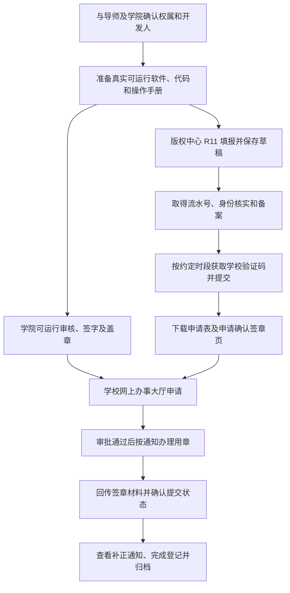

# 郑州大学软著申请指南 · 第一临床医学院

面向第一临床医学院师生，整理材料准备、可运行审核、学校验证码、版权中心登记和校内审批流程。适用于**经确认以郑州大学为著作权人**的申请；若权利人为医院、合作单位或个人，应先确认归属及对应审批渠道。

> 非学校官方文件。整理日期：2026-10-21。用户补充的院办地点为 **基础医学院院办 103**；具体办理事项、签字人、时间和预约方式仍需确认，不沿用计算机学院的老师与办公室。本文不承诺“四天拿证”。

## 从这里开始

- [材料准备与填写说明](materials.md)
- [第一临床医学院审核与待确认事项](college-review.md)
- [学校验证码办理](verification.md)
- [提交前检查清单](checklist.md)
- [空白填写模板](templates.md)
- [材料来源、差异与更新记录](sources.md)

## 一张图看懂流程

学院审核与版权中心草稿准备可并行，实际先后及材料要求以承办方为准。

## 1. 先确认身份和权利归属

开发人、著作权人、办理人是不同概念。开发人填写实际参与开发的人员，顺序与导师商定；著作权人根据实际权属和学校审核意见确定；个人账号可以作为办理入口，但不意味着著作权归个人。

所提供学校《流程.pdf》要求在版权中心选择“我是代理人”、著作权人填写“郑州大学”。该路径仅用于学校作为权利人的情形。学校证件名称、号码等从当前有效证明材料核对，不照抄历史截图。

## 2. 准备三类核心材料

| 材料 | 要点 | 提交去向 |
| --- | --- | --- |
| 程序鉴别材料 | 真实源代码；名称、版本和页码统一 | 版权中心、校内系统按要求上传 |
| 文档鉴别材料 | 与当前软件相符的操作手册及截图 | 版权中心、校内系统按要求上传 |
| 可运行审核表 | 全部内容保持一页；由审核老师核实运行，单位签字盖章 | 学院审核及校内申请 |

**不存在通用的“至少 3000 行代码才能申请”门槛。**一般交存按源程序和文档分别整理：前、后各连续 30 页，不足 60 页提交全部；除特定情况外，程序每页不少于 50 行、文档每页不少于 30 行。图文手册具体排版按办理要求处理，不为凑页数重复代码或截图。依据：[国家版权局《计算机软件著作权登记办法》第十条](https://www.ncac.gov.cn/xxfb/flfg/bmgz/202410/t20241015_869486.html)。

源程序量按完整实际源程序统计，并记录统计范围；交存文件的行数不一定等于软件全部代码行数。详见[材料说明](materials.md)。

## 3. 完成第一临床医学院可运行审核

**院办地点：基础医学院院办 103（用户于 2026-10-21 补充，具体受理事项及时间到场前确认）。**本指南的适用对象仍为第一临床医学院，办公室地点不等同于申报单位名称。

准备可演示软件、运行环境说明、手册及审核表，向学院当前负责科研或知识产权事务的老师确认审核安排。审核表填写“第一临床医学院”前，确认其与本次实际申报单位一致。

审核老师填写运行情况并签字；单位意见由审核单位按表格要求手写，并完成相应签字盖章。不要自行代签，也不要把示例中的运行描述当作审核结论。详见[学院审核说明](college-review.md)。

## 4. 版权中心填报和验证码

进入[中国版权保护中心](https://www.ccopyright.com.cn/)，选择软件登记中的“计算机软件著作权登记申请（R11）”。旧系统入口可参考[软件登记页面](https://register.ccopyright.com.cn/registration.html#/registerSoft)，如失效从官网首页进入。

依次核对办理身份、软件基本信息、开发信息、著作权人、功能与技术特点，上传相应鉴别材料。名称、版本、日期、发表状态、开发方式和环境均据实填写，不能照抄示例或“随意填写日期”。先保存草稿，记录流水号。

按所提供学校流程联系 `zzurjsq`（使用前通过学校渠道确认当前账号），完成身份核实、提交软件名称和流水号、填写对方发放的备案表。校园卡照片仅私下发给核实后的承办方。

所提供验证码通知标明：**每周一 09:00–12:00、14:30–18:00，验证码有效期 24 小时**。该通知没有标注发布日期，最新安排须向承办方确认。在线点击发送验证码后，再联系承办方并发送流水号。详细步骤见[验证码指南](verification.md)。

完成该环节后，在事项详情中下载系统生成的申请表及申请确认签章页。两者分别保存，检查项目名称和流水号一致。

## 5. 学校网上办事大厅申请及用章

打开[计算机软件著作权登记申请办事指南](https://cms.v.zzu.edu.cn/zz_portal/guide?id=3123C41A-53E1-4C81-B359-CF3875BFFC7F)，登录后按当前表单要求填报并上传材料；找不到事项时搜索“软件著作权”。

建议提前备齐：版权中心申请表、学院审核后的可运行审核表、程序鉴别材料、操作手册、待签章页，以及系统要求的其他证明。**附件栏名称、数量、是否需要打印登记表，以登录后表单和审核通知为准。**

2026-10-21 查阅的公开指南显示：

| 项目 | 公开指南内容 |
| --- | --- |
| 主办部门 | 科学技术处 |
| 办理时间 | 工作日 |
| 办理地点 | 综合管理中心 413 室 |
| 办理方式 | 网上申请，网上办结 |
| 预计时限 | 3 个工作日内 |
| 咨询电话 | 0371-67781696 |

以上是校内事项信息，不是版权登记出证时限。公开指南同时提及加盖郑州大学公章及事业单位法人证书；是否需要线下递交、携带哪些纸质件，应在审批通过后向承办方确认。旧经验中的“周四上午、301 室”不作为当前固定安排。

## 6. 回传、补正和归档

按版权中心当前事项要求上传清晰、完整的签章材料，并确认已完成提交；持续查看系统通知。有补正时按通知修改对应材料；涉及名称、权利人等变更时，先确认是否需要重新签章，不能一概认为不用重签。

将最终申请表、签章件、交存代码、手册、软件版本和登记证书一起归档。内部备份与公开教程分开保存。证书是否发放以系统状态为准，勿把校内预计时限或过往申请经验当作拿证承诺。

## 常见问题

**学生都应选“我是代理人”吗？** 本教程中的选择来自以郑州大学为著作权人的学校流程，并不适用于所有个人申请。

**可以直接改示例中的名字吗？** 模板可参考结构，但功能、代码、日期、权属和运行环境必须对应自己的软件。

**医疗软件截图用什么数据？** 使用模拟数据，移除患者姓名、病历号、联系方式、真实健康记录及登录凭据；教程无需发布真实业务数据。

**第一临床医学院具体找哪位老师？** 当前材料未给出可核实的人选和办公地点，见[待确认清单](college-review.md)。

## 反馈与致谢

感谢 [George551556/zzu-SCA](https://github.com/George551556/zzu-SCA) 提供郑州大学申请流程参考。本仓库针对第一临床医学院重新组织文字，未整包转载其截图、模板及源码。资料来源和已修正内容见[来源说明](sources.md)。

欢迎通过 [Issues](https://github.com/icannotdoany/zzu-ruanzhu/issues) 补充学院通知或流程变化，请注明来源和日期，并去除个人信息、验证码和签章。第三方材料权利归其权利人；本仓库不对这些材料作额外授权。
