# 郑州大学软件著作权申请流程

### 1.在中国版权保护中心官网提交材料

网址：https://www.ccopyright.com.cn/

选择我是代理人

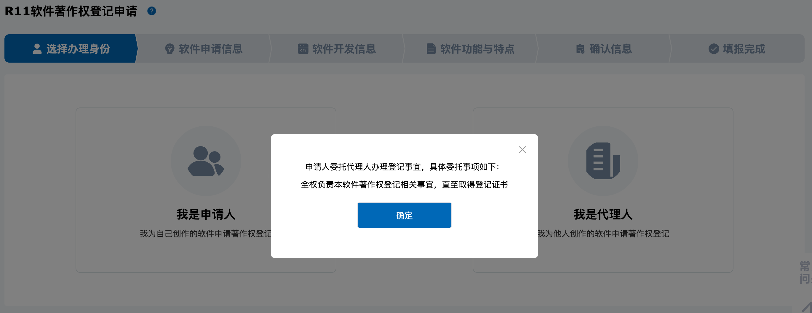

著作权人写郑州大学

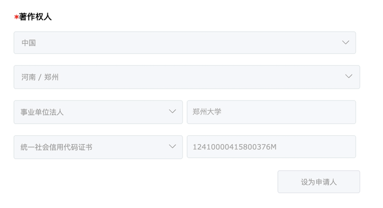

检查好提交材料的内容与格式

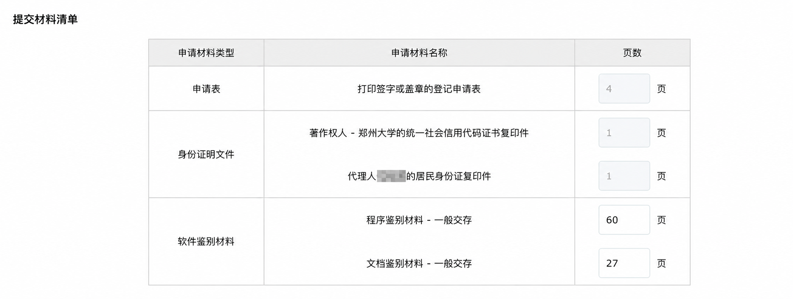

### 2. 添加微信获取申请验证码

验证码用于官网提交之前的验证https://www.ccopyright.com.cn/

注意办理时间为周一9:00-12:00,14:30-18:00

验证码有效期24h

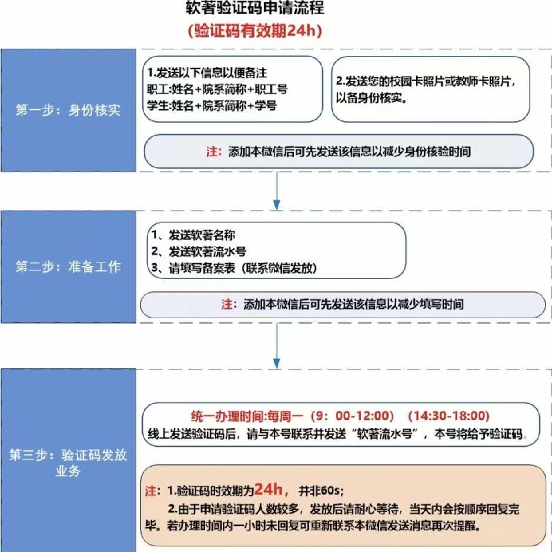

### 3. 填写郑州大学计算机软件著作权可运行审核表

[下载审核表](附件/郑州大学计算机软件著作权可运行审核表.docx)

以第一临床医学院为例，软件运行情况说明和所在单位意见签字，需要去基础医学院院办103找辅导员老师办理

盖章需要去东校区国教楼113

### 4.打印签章页

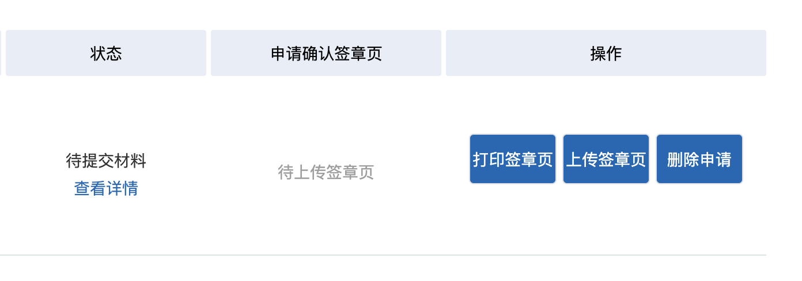

### 5.查看并下载申请表

从上图查看详情进入

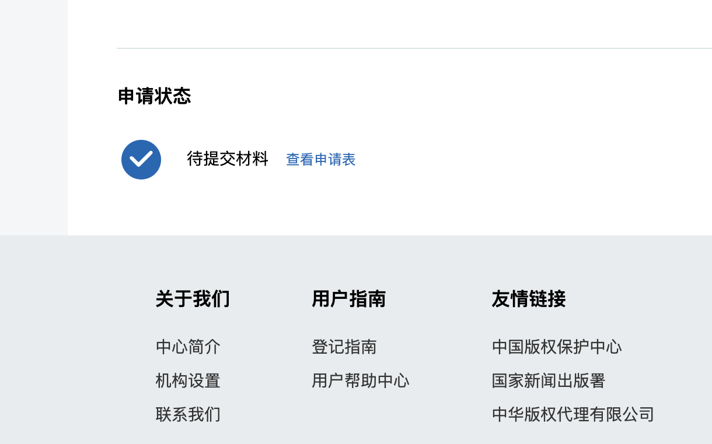

### 6.在综合信息门户-网上办事大厅提交用章申请

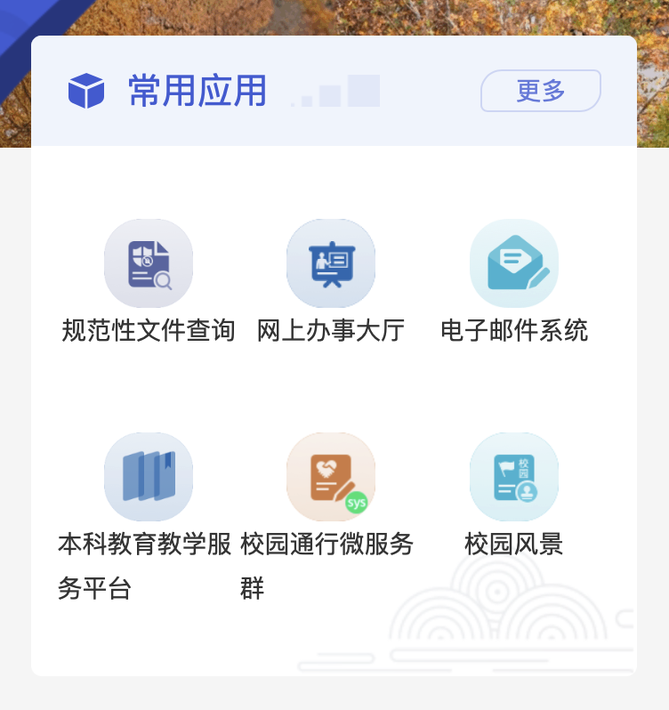

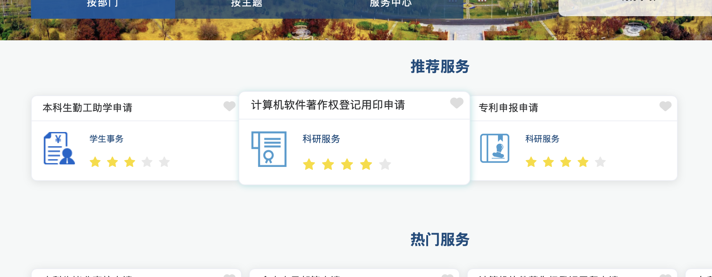

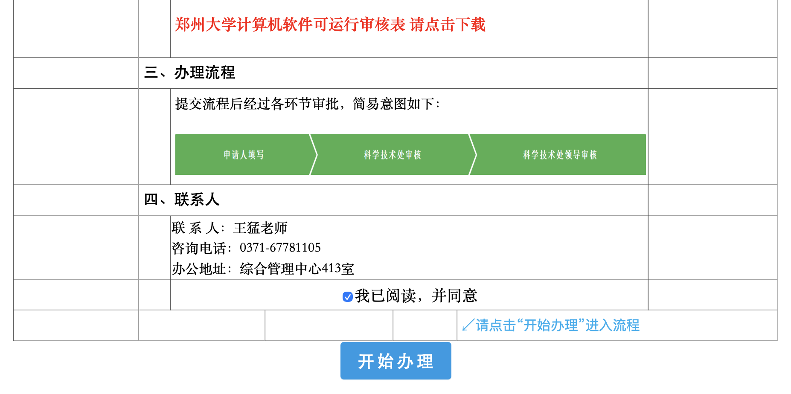

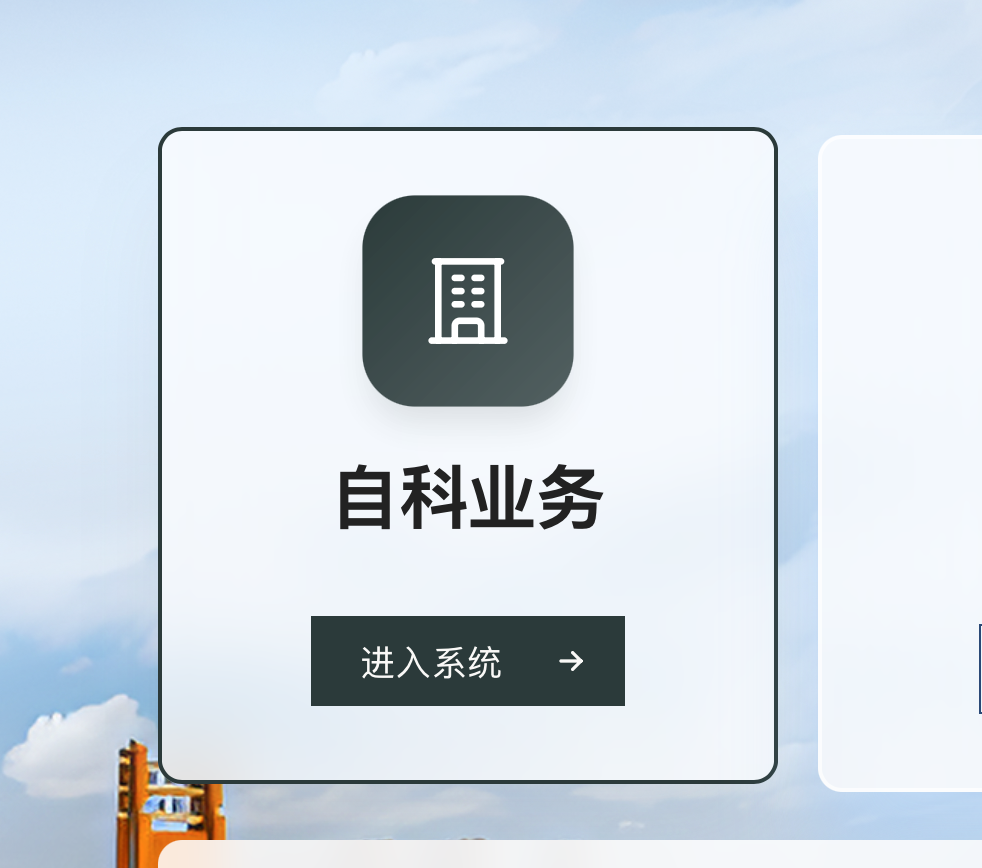

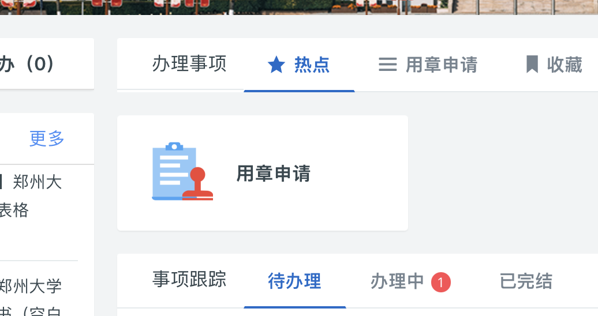

### 7.用章申请所需的文件

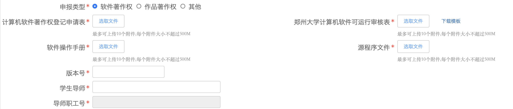

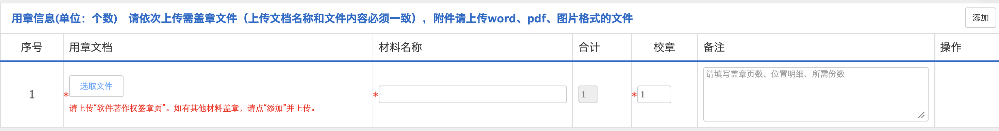

### 8.等待申请流程完成

流程完成后由申请人打印表单，（由各院系统一收集后）每周四上午到综合管理中心301房间办理

### 9.上传签章页

